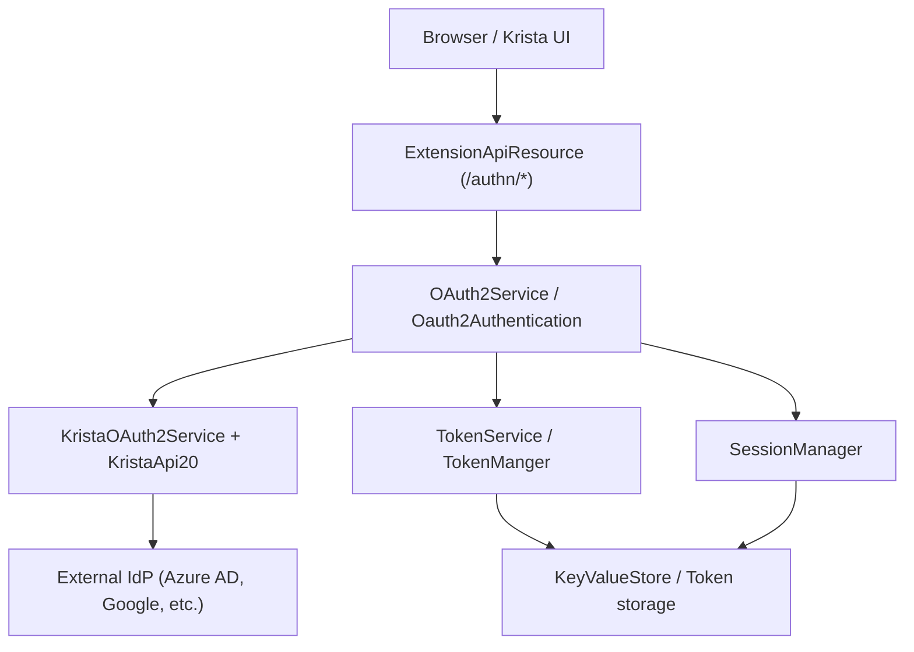
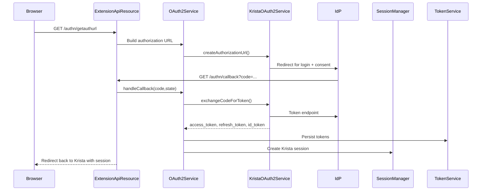

# OAuth2 Authentication Extension – Architecture

## 1. Purpose
This document describes the internal architecture of the OAuth2 Authentication extension, focusing on layers, key flows, performance characteristics, and error scenarios.

## 2. Layered Architecture
The extension follows a multi‑layered architecture:

1. **Presentation / HTTP API layer**
   - JAX‑RS resources (e.g., `ExtensionApiResource`) exposed under `/authn/*`.
   - Handles HTTP concerns: query parameters, headers, redirects, cookies, and response codes.
2. **Authentication Orchestration layer**
   - `OAuth2Service`, `Oauth2Authentication`, `SessionManager`.
   - Orchestrates OAuth2/OIDC flows, state validation, session creation, and logout.
3. **Domain / Business layer**
   - `Configuration`, `Validator`, `Oauth2ExtensionConstants`.
   - Encapsulates extension configuration, validation rules, and domain concepts (invoker attributes, roles).
4. **Infrastructure / Integration layer**
   - `KristaOAuth2Service`, `KristaApi20`, `TokenService`, `TokenManger`, `TokenInfo`.
   - Integrates with external IdPs via ScribeJava and with Krista persistence via `KeyValueStore`.
5. **Bootstrap & Support layer**
   - `Oauth2AuthenticationExtension`, `KsdkApplication`, utility classes (`OAuth2Util`, `CommonUtils`, `CSVUtils`).
   - Declares extension metadata, config fields, catalog requests, and registers REST resources and exception mappers.

## 3. High‑Level Component Diagram
The following diagram shows the main components and their interactions:

## 4. Key Flows

### 4.1 Authorization Code Login Flow

### 4.2 Token Refresh and Revoke
- **Refresh** (`/authn/refreshtoken`):
  - Validates invoker and domains.
  - Loads existing refresh token from `TokenService`.
  - Uses `KristaOAuth2Service` to obtain a new access token.
  - Persists updated token set and returns status to the caller.
- **Revoke** (`/authn/revoketoken`):
  - Reads active tokens from `TokenService`.
  - Invokes IdP revoke endpoint via `KristaOAuth2Service`.
  - Cleans up token records and may terminate the session via `SessionManager`.

## 5. Performance Characteristics and Limitations
- **Network‑bound operations**
  - Authorization, token, refresh, and revoke calls depend on the IdP’s latency and availability.
  - Timeouts and connectivity issues surface as authentication errors; the extension itself is lightweight.
- **Token storage**
  - Tokens are stored via `TokenService`/`TokenManger` into `KeyValueStore`.
  - On first upgrade, `CSVUtils` may migrate legacy CSV tokens; this is I/O heavy but run once per environment.
- **Session creation**
  - `SessionManager` uses Krista core services; performance depends on account/role resolution complexity.
- **Scalability**
  - Stateless HTTP endpoints; session and token data in shared stores enable horizontal scaling.
  - IdP throttling and rate limits are the primary external constraints.

## 6. Error Handling and Common Failure Scenarios
- **Misconfiguration**
  - Missing or invalid `CLIENT_ID`, `CLIENT_SECRET`, endpoints, or `CALLBACK_URL` are detected by `Validator` and `Oauth2Authentication`.
  - Such errors are surfaced early, often when calling `/authn/getauthurl`, with mapped responses via `KristaExceptionMapper("oauth2")`.
- **Domain and redirect validation**
  - `SUPPORTED_DOMAINS` and redirect URIs are validated; mismatches lead to rejected requests and explanatory error responses.
- **OAuth2/OIDC protocol errors**
  - Invalid or expired authorization codes, invalid state, or replayed callbacks cause the callback handler to fail validation and return errors.
  - Token endpoint failures (HTTP 4xx/5xx) from the IdP are propagated as authentication failures with logged details.
- **Token persistence issues**
  - Failures writing to or reading from `KeyValueStore` can break refresh/revoke operations; the extension surfaces storage‑related errors to the caller.
- **Session lifecycle problems**
  - If `SessionManager` cannot create or delete sessions (e.g., due to downstream issues), login or logout flows may partially complete; the user will see an authentication failure and must retry.

## 7. Operational Considerations
- **Observability**
  - Logging around `/authn/*` endpoints, token operations, and configuration validation is critical for diagnosing issues.
- **Security**
  - Client secrets are marked as secured attributes; ensure secrets are stored only in secure configuration stores.
  - Always configure HTTPS for all IdP endpoints and the Krista callback URL.
- **Upgrades**
  - `invokerUpgrade` handles token migration and configuration normalization; run against non‑production first when changing major OAuth2 settings or IdP tenants.

