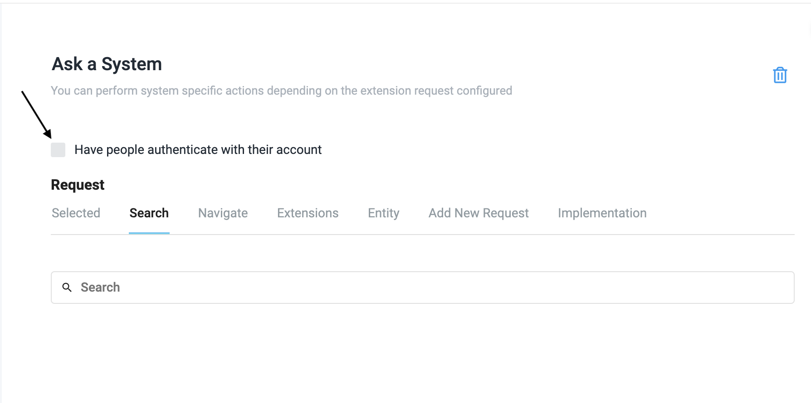
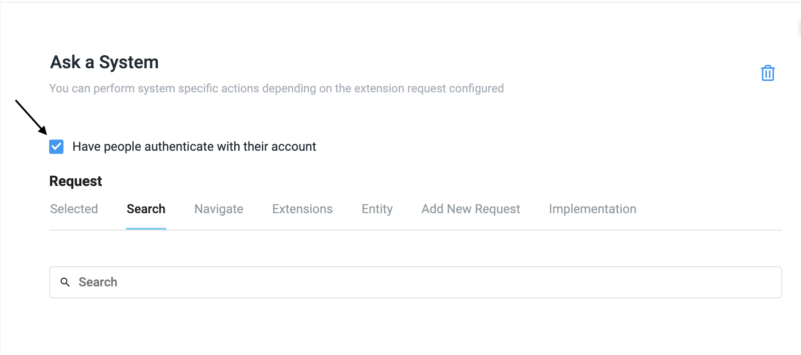

# Authentication

## Overview

This page explains how the OAuth2 Authentication extension signs users in and which authentication modes are available when you configure conversations in Krista.

## Authentication Modes

The OAuth2 Authentication extension supports two authentication modes for executing conversations:

| Mode | Checkbox State | Description |
|------|----------------|-------------|
| Service Account | Unchecked | Uses the service account configured during extension setup |
| User Account | Checked | Requires the end user to authenticate with their own account |

### Service Account Authentication

When you **uncheck** the **Have people authenticate with their account** checkbox, the service account is used while executing the conversation. This is the same account that is configured and validated during extension setup. Use this mode when:

- All actions should run under a shared/system identity.
- You do not need per-user audit trails at the provider.
- Background or scheduled operations need to run without user interaction.



### User Account Authentication

When you **check** the **Have people authenticate with their account** checkbox, each user must sign in with their own account while executing the conversation. Use this mode when:

- You need to track actions per individual user.
- Permissions should follow the user’s own account and roles in the provider.
- You want users to control access to their own data.



## OAuth 2.0 Scopes and Permissions

The **Scope** configuration defines what the extension is allowed to do on behalf of the signed-in user or service account.

- Use the minimum set of scopes required for your scenario (least privilege).
- Follow the provider’s documentation for the exact scope strings.

Example scopes:

| Provider | Example Scopes | Purpose |
|----------|----------------|---------|
| Microsoft Graph | `openid profile email offline_access User.Read` | Sign-in, basic profile, and read user information |
| Google | `openid email profile https://www.googleapis.com/auth/userinfo.email` | Sign-in and read basic profile details |

The extension does not enforce specific scopes; it forwards the configured scopes to the provider.

## OAuth 2.0 Grant Types

The extension supports the following OAuth 2.0 grant types via the **Flow Type** configuration:

### Authorization Code Grant

- **Grant Type**: `authorization_code`
- **Used For**: Interactive user sign-in (recommended)

**Token Request Example**

```http
POST https://login.microsoftonline.com/common/oauth2/v2.0/token
Content-Type: application/x-www-form-urlencoded

client_id=<client-id>&
client_secret=<client-secret>&
grant_type=authorization_code&
code=<authorization-code>&
redirect_uri=<callback-url>&
scope=<scopes>
```

### Client Credentials Grant

- **Grant Type**: `client_credentials`
- **Used For**: Server-to-server or background operations using a service identity.

### Implicit Grant (Legacy)

- **Grant Type**: `implicit`
- **Used For**: Legacy browser-only applications.
- **Note**: Most providers now recommend Authorization Code with PKCE instead of implicit.

## Authentication Flow

At runtime, authentication follows this flow:

1. Client calls **Get Authorization URL**: `GET <Extension Base URL>/rest/authn/getauthurl` (optionally with `roles` and `X-Krista-Original-URI`).
2. The extension validates configuration and returns an HTTP 302 redirect to the provider's authorization page.
3. The user signs in and consents to the requested scopes.
4. The provider redirects the browser to the configured **Callback Url**, which maps to `GET <Extension Base URL>/rest/authn/callback`.
5. The extension exchanges the authorization code for tokens, validates the response, and creates a Krista client session.
6. The browser is redirected back to the original URI, with a session cookie set.

For endpoint details, see [API Requests](pages/APIRequests.md).

## Token Management and Expiration

When authentication succeeds, the extension stores token information for the account:

- **Access token lifetime (stored)**: approximately **59 minutes**.
- **Refresh token lifetime (stored)**: approximately **24 hours**.

These durations are derived from the extension's token storage logic and may differ from the actual lifetimes enforced by the identity provider. When an access token expires, your integration can call the **Refresh Token** endpoint (`/rest/authn/refreshtoken`) to obtain a new access token using the stored refresh token.

## Token Expiration Scenarios

- **Access token expired** – Calls to downstream APIs start failing with authorization errors. Use the **Refresh Token** endpoint or re-initiate the OAuth flow.
- **Refresh token expired or revoked** – The provider no longer accepts the refresh token. The user must complete the full sign-in flow again.
- **Session invalidated** – If the Krista client session is invalidated, the user may be prompted to re-authenticate even if tokens are still valid.

## Security Best Practices

- Use HTTPS for all OAuth endpoints and for the Krista extension base URL.
- Limit scopes to the minimum required for your business scenario.
- Periodically review which users and applications have access in the provider console.
- Configure **Supported Domains** and **Allow Auto Person Creation** to match your organization’s security policies.

## Troubleshooting Authentication

- **"Null authentication response from oAuth service provider."** – The provider did not return a valid token response. Check client credentials, scopes, and redirect URI.
- **"JWT token type is not Bearer."** – The token type in the response is unexpected. Ensure you are using a standard OAuth 2.0 / OpenID Connect flow.
- **"JWT Token information not found in oAuth response."** – The response does not contain an `id_token`. Verify that OpenID scopes such as `openid` and `email` are configured.
- **"Email address not found from JWT claims."** – The extension could not resolve the user’s email from the JWT claims. Confirm which claim contains the email for your provider and that the corresponding scope is granted.

## Related Topics

- [Extension Configuration](pages/ExtensionConfiguration.md)
- [Creating OAuth App](pages/CreatingOAuthApp.md)
- [Overview](pages/overview.md)
